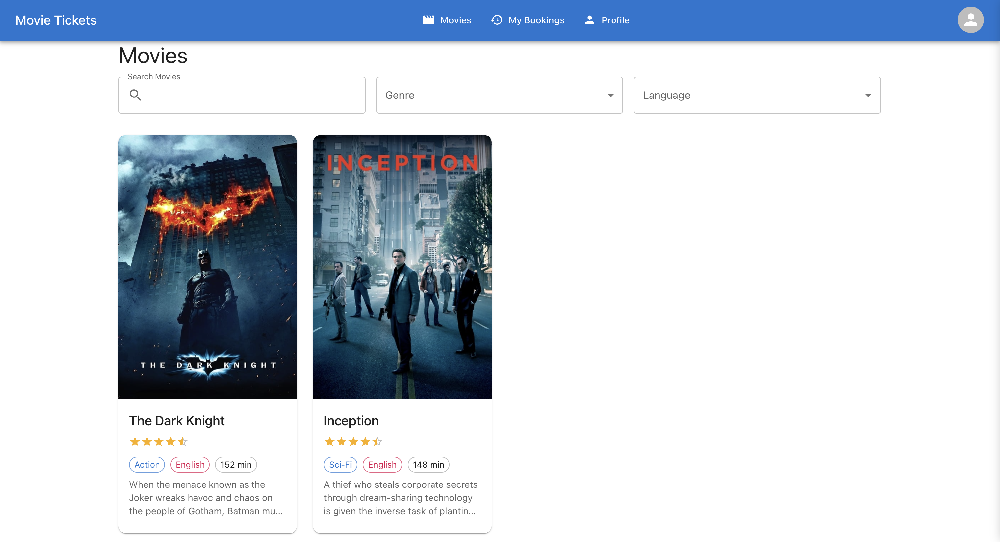
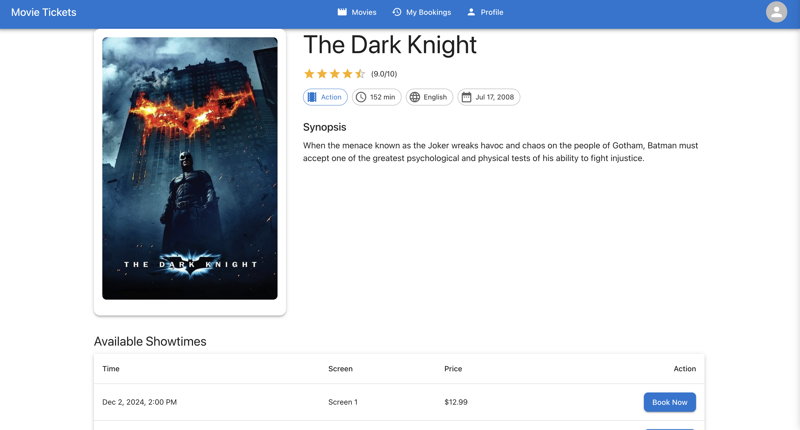
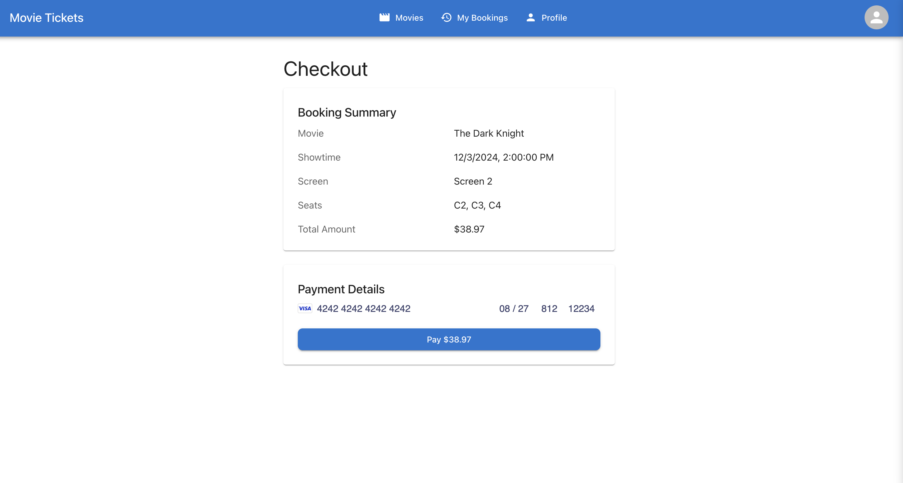
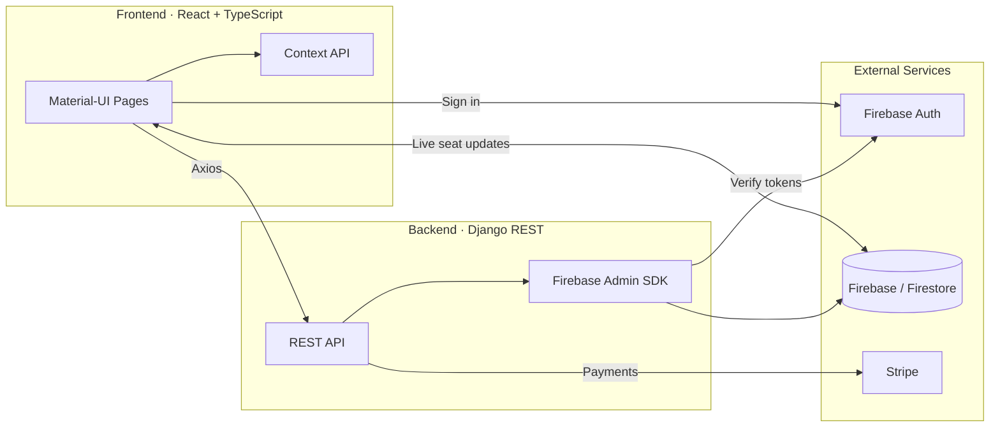

<div align="center">

# 🎬 Real-Time Movie Ticket Booking System

### Book movie tickets with live seat availability, secure payments, and instant confirmations.

[](https://react.dev/)
[](https://www.django-rest-framework.org/)
[](https://firebase.google.com/)
[](https://stripe.com/)
[](https://mui.com/)
[](https://www.python.org/)
[](./LICENSE)

[Features](#-features) · [Screenshots](#-screenshots) · [Tech Stack](#-tech-stack) · [Architecture](#-architecture) · [Getting Started](#-getting-started) · [Author](#-author)

</div>

---

## 📖 Overview

**Real-Time Movie Ticket Booking System** is a full-stack web application for browsing movies, picking seats, paying online, and managing bookings. Seat availability is synchronized live across all connected users, so two people can never book the same seat.

A **React + TypeScript** frontend works with a **Django REST Framework** backend. **Firebase** handles authentication and real-time data, and **Stripe** processes payments.

---

## ✨ Features

| Feature | Description |
| --- | --- |
| 🎬 **Movies & Showtimes** | Browse movies and their available showtimes. |
| 🎫 **Interactive Seat Selection** | Pick seats on a live seat map that updates in real time. |
| 🔄 **Concurrent Booking Protection** | Seats taken by other users update instantly, preventing double bookings. |
| 💳 **Secure Payments** | Card payments processed with Stripe. |
| 👤 **Authentication** | Sign-up and login with Firebase Authentication; the backend verifies users with the Firebase Admin SDK. |
| ✅ **Instant Confirmation** | Booking status and payment status update live for every client. |
| 📖 **Booking History** | View all your past and upcoming bookings in one place. |
| 📱 **Responsive Design** | Works across desktop, tablet, and mobile with Material-UI. |

---

## 🖼️ Screenshots

<table>
  <tr>
    <td align="center"><b>Home</b><br/></td>
    <td align="center"><b>Showtimes</b><br/></td>
  </tr>
  <tr>
    <td align="center"><b>Seat Selection</b><br/></td>
    <td align="center"><b>Checkout</b><br/></td>
  </tr>
  <tr>
    <td align="center"><b>Booking Confirmation</b><br/></td>
    <td align="center"><b>Movie Ticket</b><br/></td>
  </tr>
  <tr>
    <td align="center" colspan="2"><b>My Bookings</b><br/></td>
  </tr>
</table>

---

## 🧰 Tech Stack

**Frontend**

- React with TypeScript
- Material-UI (MUI) for styling
- Firebase Authentication and Firebase Realtime Database (live updates)
- Axios for API calls
- Context API for state management

**Backend**

- Django REST Framework
- Firebase / Firestore as the real-time database
- Firebase Admin SDK for server-side authentication
- Stripe for payment processing

---

## 🏗️ Architecture



- The **frontend** signs users in with Firebase and subscribes to live seat data.
- The **backend** verifies identity, manages bookings, and handles payments.
- **Firebase** keeps every connected client in sync, which is how concurrent bookings are prevented.

---

## 📁 Project Structure

```text
real-time-movie-booking-system/
├── backend/
│   ├── apps/
│   │   ├── movies/        # Movie and showtime management
│   │   ├── bookings/      # Booking and payment processing
│   │   └── users/         # User management
│   ├── core/              # Django core settings
│   └── utils/             # Firebase utilities
├── frontend/
│   ├── public/
│   └── src/
│       ├── components/    # Reusable UI components
│       ├── contexts/      # React contexts
│       ├── pages/         # Application pages
│       ├── services/      # API services
│       └── utils/         # Utility functions
├── output/                # README screenshots
├── .env.example           # Backend environment template
├── manage.py
└── requirements.txt
```

---

## 🚀 Getting Started

### Prerequisites

- Python 3.x
- Node.js and npm
- A [Firebase](https://firebase.google.com/) project (Authentication + Realtime Database/Firestore)
- A [Stripe](https://stripe.com/) account (test mode is fine)

### 1. Clone the repository

```bash
git clone https://github.com/Chintucharan/real-time-movie-booking-system.git
cd real-time-movie-booking-system
```

### 2. Backend setup (Django)

```bash
# Create and activate a virtual environment
python -m venv venv
source venv/bin/activate        # Windows: venv\Scripts\activate

# Install dependencies
pip install -r requirements.txt

# Configure environment variables
cp .env.example .env            # Windows: copy .env.example .env
# then fill in your Django, Firebase and Stripe credentials

# Start the server (http://localhost:8001)
python manage.py runserver 8001
```

### 3. Frontend setup (React)

```bash
cd frontend
npm install

cp .env.example .env            # Windows: copy .env.example .env
# then fill in your Firebase client config and Stripe publishable key

npm start
```

The app opens at **http://localhost:3000**. Make sure the frontend is pointed at the backend on port **8001**.

---

## 🔐 Environment Variables

**Backend — `.env`**

| Variable | Description |
| --- | --- |
| `SECRET_KEY` | Django secret key |
| `DEBUG` | Debug mode (`True` / `False`) |
| `ALLOWED_HOSTS` | Comma-separated list of allowed hosts |
| `FIREBASE_*` | Firebase Admin SDK credentials |
| `STRIPE_*` | Stripe API keys |

**Frontend — `frontend/.env`**

| Variable | Description |
| --- | --- |
| `REACT_APP_FIREBASE_*` | Firebase client configuration |
| `REACT_APP_STRIPE_PUBLISHABLE_KEY` | Stripe publishable key |

> ⚠️ **Never commit `.env` files or Firebase service-account keys.** Only `.env.example` belongs in the repository. Use Stripe **test keys** for development.

---

## ⚡ Real-Time Features

- Seat availability updates instantly when other users make bookings
- Booking status changes reflect immediately across all clients
- Concurrent booking prevention for the same seats
- Live updates for payment status
- Real-time notifications for booking confirmations

---

## 🛠️ Troubleshooting

- **Frontend can't reach the API** — confirm the backend is running on port 8001 and the frontend is configured for that address.
- **Firebase errors on startup** — double-check that every `FIREBASE_*` / `REACT_APP_FIREBASE_*` value in your `.env` files is filled in.
- **Payments failing** — make sure you're using matching Stripe **test** keys on both the backend and the frontend.
- **Env changes not applied** — restart `npm start` after editing the frontend `.env`.

---

## 🗺️ Roadmap

- [ ] Temporary seat holds with a timeout during checkout
- [ ] Email confirmation with a downloadable ticket
- [ ] Admin dashboard for managing movies and showtimes
- [ ] Docker setup for one-command local development
- [ ] Automated tests and CI pipeline

Have an idea? [Open an issue](https://github.com/Chintucharan/real-time-movie-booking-system/issues).

---

## 🤝 Contributing

1. Fork the repository
2. Create a feature branch: `git checkout -b feature/your-feature`
3. Commit your changes: `git commit -m "Add your feature"`
4. Push the branch: `git push origin feature/your-feature`
5. Open a Pull Request

---

## 📄 License

This project is licensed under the **MIT License**. See the [`LICENSE`](./LICENSE) file for details.

---

## 👤 Author

**Gowni Venkat Charan** — B.Tech CSE, Madanapalle Institute of Technology and Science (MITS)

[](https://github.com/Chintucharan)
[](https://www.linkedin.com/in/gowni-venkat-charan-1b06562a8/)

<div align="center">

⭐ If you found this project useful, consider giving it a star!

</div>
